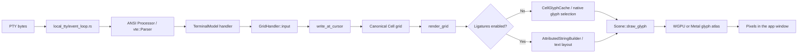
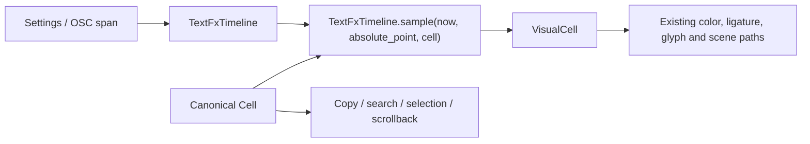

# Text FX for 0term — Technical map and plan

Product spec: `specs/txtfx/PRODUCT.md`

Source project: `txtFX/` (`100mountains/txtFX`)

## What was found in txtFX

The original project is a Python `threading.Thread` which parses its own inline `@...`/`^...` markup and repeatedly writes ANSI cursor movement, colors, and replacement characters to stdout. It contains:

- Seven text modes (`typefx0` through `typefx6`).
- Eight spinner frame sets.
- Named/256-color foreground, named background, text attributes, cursor movement, bullets, rainbow, random case, text color cycling, spinner color cycling, cursor visibility, and FPS override.
- A later `origin/rewrite` branch that separates the monolith into an input parser and animation engine.

The rewrite is not a finished engine. It preserves most of the original state machine and defects while introducing additional parser/data-flow problems. Port the observable ideas, not either Python architecture.

### Confirmed unfinished or broken behavior

- `spin_advance()` reads `self.clock_res`, but no constructor initializes it. Starting a real spinner raises `AttributeError`.
- `manager.eko()` starts the thread and discards the handle, so a caller cannot stop a persistent spinner.
- The boolean `self._stop` shadows `threading.Thread._stop`, which can break thread joining.
- `txt_cycle()` exists, but its call sites are commented out; `@txtcycle` has no visible effect.
- The documented `@;y` positioning form attempts to parse an empty integer. Bare `@` home is also not implemented as documented.
- Named-color escape construction can produce doubled escape prefixes.
- `typefx5` contains `if self.cap_index2 == 0: self.cap_index2 -= 1`, leaving the intended left-half sweep effectively dead.
- Timing mixes seconds and milliseconds and targets roughly half the configured FPS.
- Parsing splits on whitespace, so it cannot reliably preserve exact spaces and line breaks.
- The rewrite classifies all `@...` commands as attributes, flattens configuration text, omits `bpoints` required by the engine, and still has no spinner lifecycle.

Local smoke checks confirmed that modes 0–6 can execute without an exception when timing is disabled and no spinner is used. That is not evidence that modes 3–6 are visually correct. All eight spinner frame sets advance if `clock_res` is manually supplied, confirming the frame data itself is usable.

## How Krust displays a character today



### 1. PTY read and parse

`app/src/terminal/local_tty/event_loop.rs` reads PTY bytes in batches. While holding the terminal model lock it calls `ansi::Processor::parse_bytes`, then sends a wakeup so the view repaints.

`app/src/terminal/model/ansi/mod.rs` wraps `vte::Parser`. Printable Unicode reaches `VtePerform::print`, which calls the active ANSI handler's `input(c)`. CSI/OSC/DCS sequences are dispatched through the same handler interface.

### 2. Terminal model and canonical grid

`app/src/terminal/model/terminal_model.rs` routes `input(c)` to the active surface: a primary-screen block grid or the alternate screen.

`app/src/terminal/model/grid/ansi_handler.rs` performs terminal semantics:

- determines Unicode display width;
- attaches zero-width codepoints to the preceding cell;
- handles wrapping, insertion, wide-character spacers, cursor motion, scrolling, and SGR state;
- calls `write_at_cursor`, which stores the character, foreground, background, and flags in a `Cell`.

`crates/krust_terminal/src/model/grid/cell.rs` defines `Cell`. It is deliberately packed into 24 bytes. Adding one byte would increase it to 32 bytes, so Text FX must not add always-present animation fields to every cell.

The grid already provides `AbsolutePoint`, a row/column coordinate adjusted by `num_lines_truncated`. Text FX should use this for short-lived visual spans so scrollback truncation cannot move an animation onto unrelated text.

### 3. Grid rendering

Both primary-screen blocks and the alternate screen converge on `app/src/terminal/grid_renderer.rs::render_grid`:

- `BlockListElement` paints prompt/command/output `BlockGrid`s through `BlockGrid::draw`.
- `AltScreenElement` passes its active grid directly to `render_grid`.

The non-ligature path visits each visible cell, resolves foreground/background, links, find matches, secrets, wide characters, and decorations, then calls `render_cell_glyph`. `CellGlyphCache` maps character-or-grapheme plus font to a glyph ID. Box drawing, block elements, and Powerline characters may use native drawing instead of a font glyph.

The ligature path builds an attributed string for each row and a character-index-to-grid-column map, asks Krust's text layout system to shape the line, and paints shaped glyphs back at terminal cell positions.

### 4. Scene and GPU

`crates/krustui_core/src/scene.rs::draw_glyph` records glyph ID, font ID, size, position, and color. The WGPU/Metal backends rasterize missing glyphs into an atlas and draw instances. Text FX does not need a shader for the original effects; it can choose visual content/color before `draw_glyph`.

### 5. Animation clock

KrustUI already supports self-sustaining local animation through `PaintContext::repaint_after`. `ShimmeringTextElement` and `LiveElement` use an `Instant`, sample current visual state during paint, and schedule only the next required repaint. Text FX should follow this model instead of creating worker threads.

## Proposed insertion point



Insert a render-time adapter immediately after a renderer obtains a canonical `Cell` and before it chooses the displayed glyph and foreground color.

Conceptual API:

```rust
pub struct VisualCell<'a> {
    pub content: CharOrStr<'a>,
    pub foreground_override: Option<Color>,
    pub opacity: f32,
}

pub struct TextFxSample<'a> {
    pub visual: VisualCell<'a>,
    pub needs_repaint: bool,
}
```

The sampler is a pure function of:

- effect definition;
- start time and elapsed time;
- stable seed;
- cell ordinal and total span length;
- original grapheme and display width.

Random-looking effects must hash `(instance_seed, absolute_point, frame_number)` rather than mutate an RNG during paint. The same frame is therefore stable across extra repaints, tests are deterministic, and no lock is required.

Animation and colour are sampled as independent layers. Named colours produce `Color::Named` so they follow the active terminal theme; rainbow produces deterministic `Color::Spec` values. The renderer applies the temporary foreground to a cloned visual cell in both ligature and non-ligature paths. Canonical cell colour is never mutated, and all colour treatments end by returning to the application's original foreground.

## State model

Add a sparse timeline to `GridHandler`, not to `Cell`:

```rust
struct TextFxTimeline {
    transient_batches: VecDeque<TextFxBatch>,
    explicit_spans: HashMap<TextFxId, TextFxSpan>,
}

struct TextFxBatch {
    started_at: Instant,
    effect: TextFxDefinition,
    cells: Vec<AnimatedCell>,
}

struct AnimatedCell {
    point: AbsolutePoint,
    original_fingerprint: CellFingerprint,
    ordinal: usize,
}
```

An original-content fingerprint prevents an old batch from affecting a cell that an application has overwritten. `AbsolutePoint::to_point` drops already-truncated rows. The queue is bounded; expired batches can be pruned on the next PTY batch, clear/resize operation, or explicit protocol event. Sampling an expired batch returns no repaint request even if it has not yet been pruned.

Do not use the broad existing `dirty_cells_range` as the only source of automatic effects. It also covers cursor motion and other non-printing changes. Add a batch-local accumulator updated by successful canonical cell writes, then consume it in `on_finish_byte_processing` before the existing dirty range is reset. Coalesce duplicate points so carriage-return progress output animates only the final content from that PTY batch.

For explicit begin/end spans, capture `AbsolutePoint::from_point(cursor_point, grid)` at each marker. The timeline stores the resulting ordered cells and their original fingerprints.

Persistent spinners should be explicit single-cell spans whose canonical placeholder belongs to the application. The visual spinner frame replaces that placeholder only while the instance is active. On stop, rendering immediately falls back to canonical content; the helper can overwrite it with final text. This avoids synthetic terminal content and lets ordinary grid scrolling move the real placeholder normally.

## Renderer integration

Add an optional `&TextFxTimeline`/sampler to `GridRenderParams` or expose it from `GridHandler`.

### Non-ligature path

Before `render_cell`/`render_cell_glyph`:

1. Resolve secret obfuscation first. A secret must never be supplied to an effect that can reveal or case-transform it.
2. Sample Text FX for the current absolute point.
3. Use sampled content/opacity/foreground for glyph selection.
4. Keep canonical background, flags, hyperlink, match, selection, wide-character spacer, and decoration behavior.

### Ligature path

Apply the same sample before `AttributedStringBuilder::append_content`. Hidden/unrevealed cells append placeholders so grid columns and ligature boundaries remain valid. The existing character-index-to-cell map continues to position shaped glyphs.

An effect is not allowed to change terminal display width. For a wide or multi-codepoint grapheme where no safe substitute exists, use opacity/foreground animation until the canonical grapheme is revealed. Wide-character spacer cells remain canonical placeholders.

### Repaint scheduling

`render_grid` aggregates whether any visible sample remains active. If so, its owning paint pass calls `ctx.repaint_after(frame_interval)`. No active effect means no timer. Settings changes and PTY writes already notify the view and cause immediate paint.

The primary screen and alternate screen both use `render_grid`, so core visual sampling can be shared. Scope policy is decided before batches are created, not by duplicating renderer code.

## Private control protocol

The fork now reserves OSC `9281`, immediately after Krust's current `9277`–`9280` range. The implemented spinner operations are:

```text
OSC 9281 ; spinner ; start  ; <id> ; <style> ; <fps> ST
<one normal placeholder grapheme>
OSC 9281 ; spinner ; update ; <id> ; <style> ; <fps> ST
OSC 9281 ; spinner ; stop   ; <id> ST
```

Styles accept `line`, `orbit`, `arrows`, `quarters`, `fill`, `clock`, `bar`, or `bounce` (and their original numeric positions 1–8). FPS is clamped to 1–60. IDs are limited to 64 ASCII alphanumeric, dash, underscore, or period characters.

The start operation anchors to the current cursor point. The following ordinary placeholder cell remains canonical terminal content; only its painted glyph changes. Stop immediately reveals that placeholder again, allowing the application to erase or replace it normally.

For example:

```sh
printf '\e]9281;spinner;start;build;bar;20\e\\ '
# ...later...
printf '\e]9281;spinner;stop;build\e\\\b \bBuild complete\n'
```

`script/txtfx-demo [style] [seconds]` is a local smoke-test helper for this protocol.

A versioned general text-span operation is still planned for application-requested one-shot effects. Its payload should use bounded base64url JSON so arbitrary text cannot be confused with OSC parameter separators. A prospective decoded payload is:

```json
{
  "v": 1,
  "id": "build",
  "effect": "matrix_trail",
  "speed": "normal"
}
```

Protocol rules:

- Version every payload.
- Cap encoded size, span length, duration, FPS, and concurrent IDs.
- Ignore malformed/unknown operations without printing them.
- Never read files, run commands, access the network, or log the user text from a payload.
- A duplicate ID updates/restarts the existing instance.
- `update` changes an existing instance without creating another repaint loop.
- `stop` is idempotent; clear/terminal reset drops affected instances.
- OSC-delimited ordinary text remains valid in terminals which ignore the private marker, making the helper degrade cleanly.

Do not extend `DProtoHook` for this. That schema is for registered shell lifecycle hooks and session validation. Give Text FX its own small parser and handler methods beside the existing OSC dispatch.

## Settings and feature plumbing

Suggested modules:

- `app/src/terminal/text_effects/mod.rs` — definitions, policy, timeline, sampling.
- `app/src/terminal/text_effects/picker.rs` — compact native title-bar picker.
- `app/src/terminal/text_effects/settings.rs` — settings group and enums.
- `app/src/terminal/text_effects/protocol.rs` — bounded OSC payload parser.
- `app/src/terminal/text_effects/effects/` — pure effect samplers.
- `app/src/terminal/text_effects/*_tests.rs` — deterministic unit tests.

Use the existing ligature setting as the settings pattern:

- settings group and TOML values under `appearance.txtfx.*`;
- independent `effect`/`speed`/`intensity` and `color`/`color_speed`/`color_intensity` values;
- subscribe in `TerminalView` so changes repaint active terminals;
- add an adaptive Appearance → txtFX category which only renders settings relevant to the selected animation and colour;
- add Command Palette enable/disable entries and context flags;
- gate the whole feature with one product-level feature flag while it is under development.

## Performance constraints

- No new field in every `Cell`.
- No thread, async task, channel, or lock per effect.
- No allocation per cell per frame. Store span state once and return borrowed canonical content where possible.
- Bound transient cells per batch and total active cells per grid.
- Coalesce repeated writes within one PTY batch.
- Stop or fast-forward old automatic effects when output arrives faster than animation can complete.
- Schedule at most one repaint timer per window; `PaintContext::repaint_after` already keeps the nearest timer.
- Keep backgrounds and image rendering out of the effect path.

## Correctness and safety edges

- **Secrets:** sample only already-obfuscated display content, or bypass substitution entirely for secret cells.
- **Selection/copy/search:** continue reading canonical grid content.
- **Find/link decorations:** compute ranges from canonical points; effects only alter glyph/foreground.
- **Ligatures:** preserve placeholders and character-to-cell mapping.
- **Wide/combining text:** animate grapheme units and never change display width.
- **Scrolling/truncation:** use `AbsolutePoint`; drop a sample if conversion fails or its fingerprint changed.
- **Resize/reflow:** finish affected transient batches initially. Supporting transformed spans can be a later optimization.
- **Clear/reset:** cancel spans whose canonical cells are cleared.
- **Alternate screen:** automatic effects off by default; explicit protocol opt-in.
- **Shared sessions:** raw PTY markers can be forwarded; incompatible clients ignore them and still see canonical text.
- **Exports/share previews:** render canonical completed text unless an explicit live-preview surface is requested.

## Test plan

### Pure engine unit tests

- Exact frame samples at fake timestamps for every effect.
- Deterministic output from seed, point, and frame.
- Completion returns canonical content and no repaint.
- Speed/intensity bounds and random-effect selection.
- All eight spinner sequences, wraparound, duplicate-ID update, and idempotent stop.
- Grapheme, combining mark, emoji, and wide-character fallback behavior.

### Terminal model tests

- Written-cell accumulator records prints but not cursor-only movement.
- Carriage-return rewrites coalesce to the final cell fingerprint.
- Absolute points survive scrollback movement and are dropped after truncation.
- Overwrite, clear, resize, reset, and block completion cancel or safely bypass spans.
- Protocol begin/end range capture and malformed/oversized payload rejection.

### Renderer tests

- Ligature and non-ligature paths reach the same completed visual text.
- Hidden frames preserve cell geometry.
- Background, selection, links, matches, decorations, cursor, images, and secret redaction remain correct.
- No `repaint_after` request after the final frame or with the feature disabled.

### Manual GUI verification

- Preview every effect in Settings.
- Run fast build/log output, carriage-return progress, long wrapped lines, Unicode, and large output.
- Scroll and resize during an active effect.
- Run `vim`, `less`, `tmux`, and a CLI agent in the alternate screen with automatic animation disabled.
- Start/update/stop several spinner IDs and verify CPU returns to idle after stop.

## Recommended first implementation slice

Build the pure sampler and render-time `VisualCell` adapter first, behind a feature flag, with one manually constructed typewriter span in a renderer test. Once both renderer paths preserve geometry and canonical text, add automatic written-cell capture. Add the OSC protocol and persistent spinners only after that foundation is stable.

This order proves the risky boundary—the terminal-grid-to-glyph transition—before adding settings or compatibility syntax.
